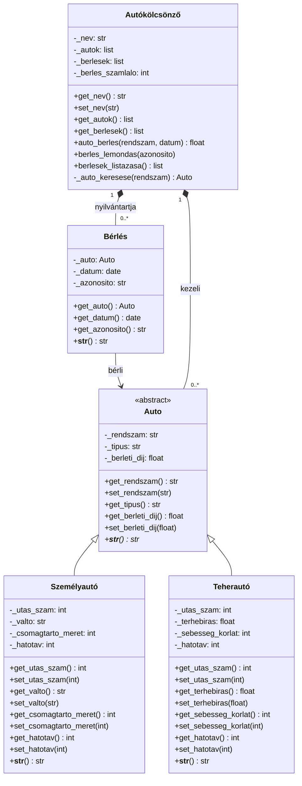
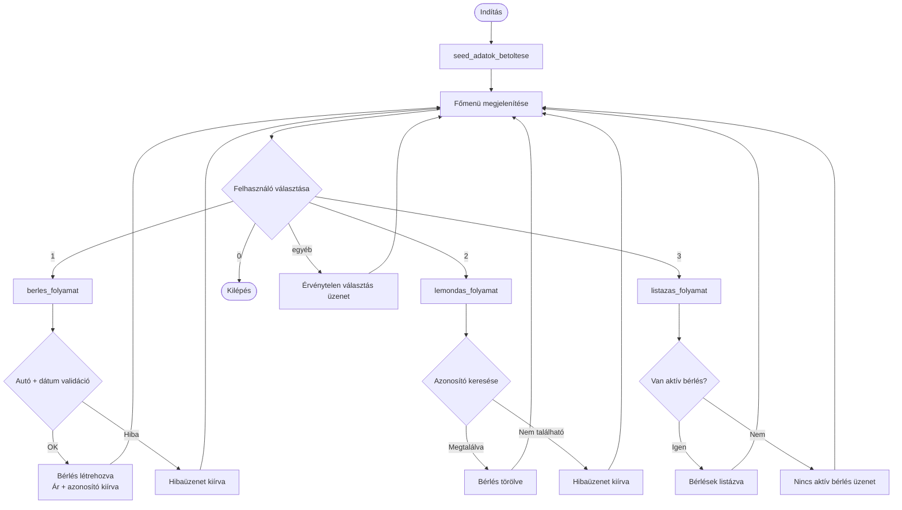

# Autókölcsönző Rendszer

Önálló, memóriában működő Python CLI alkalmazás, amely objektumorientált elvek alapján valósít meg egy autókölcsönző rendszert. Az alkalmazás lehetővé teszi, hogy a felhasználó egy napra béreljen autót, lemondjon egy meglévő bérlést, és listázza az aktív bérléseket egy számozott menün keresztül.

---

## Szerző

| | |
|---|---|
| **Név** | Czétényi Kristóf |
| **Szak** | Mérnök informatikus |
| **Intézmény** | GDE |
| **Neptun kód** | I62GFT |

---

## Futtatás

Nincs szükség semmilyen telepítésre. Python 3.9+ szükséges.

```bash
python main.py
```

Nem szükséges `pip install`. A projekt a Python standard könyvtárát használja.

---

## Funkcionalitás

- Autó bérlése egy napra
- Bérlés lemondása azonosító alapján
- Aktív bérlések listázása

---

## Projekt struktúra

```
main.py             ← belépési pont: seed betöltés + CLI hurok
auto.py             ← Auto (absztrakt alaposztály)
szemely_auto.py     ← Személyautó(Auto)
teher_auto.py       ← Teherautó(Auto)
berles.py           ← Bérlés (bérlési rekord)
autokolcsonzo.py    ← Autókölcsönző (cég + üzleti logika)
NEPTUNKOD.docx      ← GitHub repository URL a Neptun-beadáshoz
README.md           ← futtatási útmutató
```

Osztályonként egy fájl. Nincs alcsomag. Az összes modul a projekt gyökérkönyvtárában helyezkedik el az egyszerűség és a PyCharm-kompatibilitás érdekében.

---

## Domainmodell

### Osztálydiagram



---

## Osztályok

### `Auto` — Absztrakt alaposztály (`auto.py`)

A járműhierarchia gyökere. Közvetlenül nem példányosítható (`abc.ABC`).

| Attribútum | Típus | Hozzáférés | Leírás |
|---|---|---|---|
| `_rendszam` | `str` | getter + setter | Rendszám — egyedi járműazonosító |
| `_tipus` | `str` | csak getter | Járműtípus megnevezése — az alosztály konstruktora állítja be, kívülről csak olvasható |
| `_berleti_dij` | `float` | getter + setter | Napi bérleti díj forintban — pozitív szám kell legyen |

A `__str__` absztrakt metódusként van definiálva — minden alosztálynak kötelező implementálnia egy emberi olvasható szöveges reprezentációt.

---

### `Személyautó(Auto)` — Személyautó (`szemely_auto.py`)

| Attribútum | Típus | Hozzáférés | Leírás |
|---|---|---|---|
| `_gyarto` | `str` | getter | Gyártó neve |
| `_modell` | `str` | getter | Modell neve |
| `_utas_szam` | `int` | getter + setter | Utaskapacitás |
| `_valto` | `str` | getter + setter | Váltótípus: kizárólag `"manuális"` vagy `"automata"` — beállításkor validálva |
| `_csomagtarto_meret` | `int` | getter + setter | Csomagtartó mérete literben |
| `_hatotav` | `int` | getter + setter | Hatótáv km-ben |

Beállítja: `_tipus = "Személyautó"`. Érvénytelen `_valto` érték esetén `ValueError`-t dob konstruktorban és setterben egyaránt.

---

### `Teherautó(Auto)` — Teherautó (`teher_auto.py`)

| Attribútum | Típus | Hozzáférés | Leírás |
|---|---|---|---|
| `_utas_szam` | `int` | getter + setter | Utaskapacitás a kabinban |
| `_terhebiras` | `float` | getter + setter | Teherbírás kg-ban |
| `_sebesseg_korlat` | `int` | getter + setter | Sebességkorlát km/h-ban |
| `_hatotav` | `int` | getter + setter | Hatótáv km-ben |
| `_rakodter_hossz` | `int` | getter | Rakodótér hossza cm-ben |
| `_rakodter_magassag` | `int` | getter | Rakodótér magassága cm-ben |
| `_rakodter_szelesseg` | `int` | getter | Rakodótér szélessége cm-ben |

Beállítja: `_tipus = "Teherautó"`.

---

### `Bérlés` — Bérlési rekord (`berles.py`)

Konstrukció után megváltoztathatatlan — minden attribútum `__init__`-ben kerül beállításra, setterek nincsenek.

| Attribútum | Típus | Hozzáférés | Leírás |
|---|---|---|---|
| `_auto` | `Auto` | csak getter | A bérelt jármű |
| `_datum` | `datetime.date` | csak getter | Bérlés dátuma (egynapos) |
| `_azonosito` | `str` | csak getter | Egyedi azonosító — formátum: `{sorszám}-{rendszám}-{dátum}` |

**Azonosító példa:** `3-GDE-003-2026-05-20`

---

### `Autókölcsönző` — Kölcsönző cég (`autokolcsonzo.py`)

A flotta és az összes bérlési állapot tulajdonosa. Tartalmazza az összes üzleti logikát.

| Metódus | Visszatérési érték | Leírás |
|---|---|---|
| `auto_berles(rendszam, datum)` | `float` | Validál és létrehozza a bérlést. Visszaadja a napi díjat. Szabálysértés esetén `ValueError`-t dob. |
| `berles_lemondas(azonosito)` | `None` | Azonosító alapján törli a bérlést. Ha nem létezik, `ValueError`-t dob. |
| `berlesek_listazasa()` | `list[Bérlés]` | Az aktív bérlések másolatát adja vissza. |

**Az `auto_berles` validációs szabályai:**
1. A `rendszam`-nak léteznie kell a flottában.
2. A `datum` nem lehet múltbeli (≥ mai nap).
3. Nem létezhet ugyanarra az autóra ugyanarra a napra aktív bérlés.

---

## Seed adatok

Minden indításkor automatikusan betöltve:

**Járművek:**

| # | Típus | Rendszám | Díj/nap | Specifikus adatok |
|---|---|---|---|---|
| 1 | Személyautó | `GDE-001` | 15 000 Ft | Ford Mondeo, 5 utas, manuális, 400 L, 600 km |
| 2 | Személyautó | `GDE-002` | 18 000 Ft | Toyota Camry, 5 utas, automata, 350 L, 700 km |
| 3 | Teherautó | `GDE-003` | 35 000 Ft | 2 utas, 3 500 kg, 90 km/h, 800 km, 600×210×230 cm |

**Előre betöltött bérlések:**

| Azonosító | Rendszám | Dátum |
|---|---|---|
| `1-GDE-001-2026-05-02` | GDE-001 | 2026-05-02 |
| `2-GDE-002-2026-05-10` | GDE-002 | 2026-05-10 |
| `3-GDE-003-2026-05-20` | GDE-003 | 2026-05-20 |
| `4-GDE-001-2026-06-01` | GDE-001 | 2026-06-01 |

---

## Használat

**Autó bérlése:**
1. Válaszd az `1`-es lehetőséget a főmenüből.
2. A lista megjelenése után adj meg egy rendszámot (pl. `GDE-001`), vagy `d`-t a részletes adatlaphoz, vagy üres Enter a visszalépéshez.
3. Add meg a bérlés dátumát `ÉÉÉÉ-HH-NN` formátumban (mai nap vagy jövőbeli dátum szükséges).
4. Sikeres bérlés esetén a rendszer kiírja a napi díjat és az új bérlési azonosítót.

**Bérlés lemondása:**
1. Válaszd a `2`-es lehetőséget a főmenüből.
2. A rendszer listázza az aktív bérléseket azonosítóikkal együtt.
3. Add meg a lemondani kívánt bérlés teljes azonosítóját (pl. `1-GDE-001-2026-05-02`).
4. Sikeres lemondás esetén: `"Bérlés sikeresen lemondva."`

**Bérlések listázása:**
1. Válaszd a `3`-as lehetőséget a főmenüből.
2. A rendszer megjeleníti az összes aktív bérlést azonosítóval, típussal, rendszámmal és dátummal.
3. Ha nincs aktív bérlés: `"Nincs aktív bérlés."`

---

## CLI folyamatábra



---

## Feltételezések és korlátok

| Tétel | Leírás |
|---|---|
| Csak memóriában | Az összes állapot elvész, amikor az alkalmazás leáll. Nincs perzisztencia. |
| Egynapos bérlések | Minden `Bérlés` pontosan egy naptári napot fed le. Többnapos bérlés nem támogatott. |
| Nincs párhuzamos felhasználó | Egyprocesszű, egyfelhasználós CLI. |
| Rendszám alapján választunk autót | A felhasználónak pontosan be kell gépelnie a rendszámot. |
| A seed bérlési dátumok rögzítettek | A dátumok fixek (2026-05-02-től 2026-06-01-ig). Amikor ezek a dátumok elmúlnak, a bérlések historikus rekordokká válnak. |

---

## Beadási ellenőrzőlista

- [x] Töltsd fel az összes fájlt egy **publikus** GitHub repositoryba
- [x] Frissítsd a `NEPTUNKOD.docx` fájlt a publikus GitHub repository URL-jével
- [x] Ellenőrizd, hogy a repository látható-e egy incognito böngészőablakban
- [ ] Klónozd le a repositoryt PyCharm-ban, és győződj meg róla, hogy a `python main.py` hiba nélkül elindul
- [ ] Készíts egy 2–3 perces elevator pitch videót a futó alkalmazás bemutatásával, és töltsd fel a GitHub repositoryba
- [ ] Töltsd fel a `NEPTUNKOD.docx` fájlt a Neptunon a „Kötelező project feladat" feladathoz
- **Frissített határidő: 2026-12-06 23:59:59**

---

## Fejlesztői környezet

| | |
|---|---|
| **IDE** | Visual Studio Code 1.109.2 |
| **Python** | 3.14.3 |
| **Operációs rendszer** | Windows |
| **Külső csomag** | — (csak Python standard könyvtár) |

---

## Fejlesztési megjegyzés

A projekt fejlesztése során egy saját tervezésű, ágens alapú AI rendszer — **CASE + TARS** — nyújtott támogatást. A rendszer a teljes fejlesztési életciklust lefedi: a CASE a követelményeket szervezi és Feature Brief-et készít, a TARS pedig végigvezeti fejlesztést a követelményelemzéstől a dokumentációig.

Agentic módban működve a rendszer képes volt önállóan értelmezni a követelményeket, tervezni az architektúrát, implementálni a kódot, és dokumentációt generálni — mindezt emberi jóváhagyással a kritikus döntési pontokon.

Az AI rendszer kizárólag fejlesztési segédeszközként működött — minden kód, tervezési döntés és dokumentum emberi jóváhagyással készült és kerül beadásra.

> A rendszer részletes dokumentációja (ágensek, fázisok, architektúra, felhasznált lépések) külön kérésre rendelkezésre bocsátható. A dokumentáció elsősorban ipari felhasználásra készült, és olyan részleteket tartalmaz, amelyek titoktartási megállapodás (NDA) hatálya alá essnek.