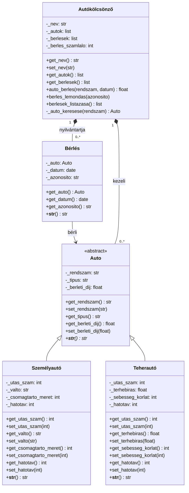
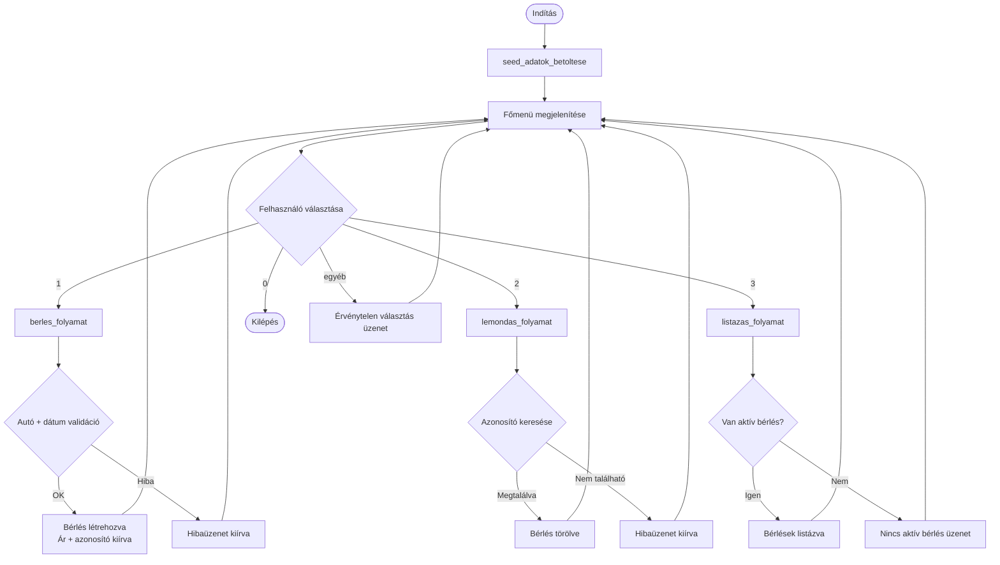
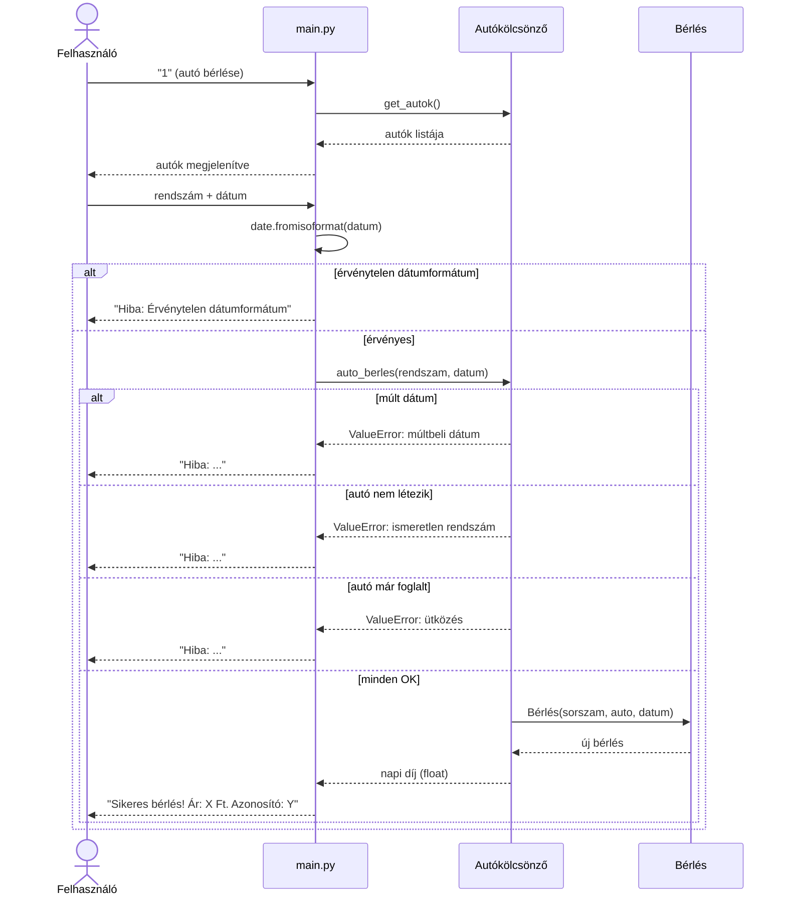

# Feature: Autókölcsönző Rendszer

**Status:** Approved  
**Author:** TARS | Documentation Writer  
**Date:** 2026-04-19 
**Approved by:** Czétényi Kristóf I62GFT
**Approval date:** 2026-04-20 
**PRD Reference:** `docs/02-prd-autokolcsonzo-rendszer.md` (PRD-001)
**Design Reference:** `docs/03-design-autokolcsonzo-rendszer.md`

---

## Áttekintés

Egy önálló, memóriában működő Python CLI alkalmazás, amely objektumorientált elvek alapján valósít meg egy autókölcsönző rendszert. Az alkalmazás lehetővé teszi, hogy a felhasználó egy napra béreljen autót, lemondjon egy meglévő bérlést, és listázza az aktív bérléseket egy számozott menün keresztül.

A projekt egy egyetemi OOP vizsgafeladat. Fő célja az absztrakció (absztrakt alaposztály), az egységbezárás (nem publikus attribútumok getter/setter metódusokkal) és az öröklés (konkrét járműalosztályok) bemutatása. Az alkalmazás semmilyen külső csomagot nem igényel — kizárólag a Python standard könyvtárát használja —, és friss `git clone` után azonnal futtatható.

Indításkor a rendszer egy kölcsönzőt tölt be előre 3 autóval és 4 meglévő bérlésssel, így a felhasználó azonnal használatra kész rendszert kap.

---

## Domainmodell

### Osztálydiagram



---

### `Auto` — Absztrakt alaposztály (`auto.py`)

A járműhierarchia gyökere. Közvetlenül nem példányosítható (`abc.ABC`).

| Attribútum | Típus | Hozzáférés | Leírás |
|---|---|---|---|
| `_rendszam` | `str` | getter + setter | Rendszám — egyedi járműazonosító |
| `_tipus` | `str` | csak getter | Járműtípus megnevezése — az alosztály konstruktora állítja be, kívülről csak olvasható |
| `_berleti_dij` | `float` | getter + setter | Napi bérleti díj forintban — pozitív szám kell legyen |

A `__str__` absztrakt metódusként van definiálva — minden alosztálynak kötelező implementálnia egy emberi olvasható szöveges reprezentációt.

---

### `Személyautó(Auto)` — Személyautó (`szemely_auto.py`)

| Attribútum | Típus | Hozzáférés | Leírás |
|---|---|---|---|
| `_utas_szam` | `int` | getter + setter | Utaskapacitás |
| `_valto` | `str` | getter + setter | Váltótípus: kizárólag `"manuális"` vagy `"automata"` — beállításkor validálva |
| `_csomagtarto_meret` | `int` | getter + setter | Csomagtartó mérete literben |
| `_hatotav` | `int` | getter + setter | Hatótáv km-ben |

Beállítja: `_tipus = "Személyautó"`. Érvénytelen `_valto` érték esetén `ValueError`-t dob konstruktorban és setterben egyaránt.

---

### `Teherautó(Auto)` — Teherautó (`teher_auto.py`)

| Attribútum | Típus | Hozzáférés | Leírás |
|---|---|---|---|
| `_utas_szam` | `int` | getter + setter | Utaskapacitás a kabinban |
| `_terhebiras` | `float` | getter + setter | Teherbírás kg-ban |
| `_sebesseg_korlat` | `int` | getter + setter | Sebességkorlát km/h-ban |
| `_hatotav` | `int` | getter + setter | Hatótáv km-ben |

Beállítja: `_tipus = "Teherautó"`.

---

### `Bérlés` — Bérlési rekord (`berles.py`)

Konstrukció után megváltoztathatatlan — minden attribútum `__init__`-ben kerül beállításra, setterek nincsenek.

| Attribútum | Típus | Hozzáférés | Leírás |
|---|---|---|---|
| `_auto` | `Auto` | csak getter | A bérelt jármű |
| `_datum` | `datetime.date` | csak getter | Bérlés dátuma (egynapos) |
| `_azonosito` | `str` | csak getter | Egyedi azonosító — formátum: `{sorszám}-{rendszám}-{dátum}` |

**Azonosító példa:** `3-GDE-003-2026-05-20`

Az azonosítót a konstruktor állítja össze az `Autókölcsönző` által átadott sorszámból, az autó rendszámából és a bérlési dátumból. A bérlés teljes élettartama alatt változatlan marad.

---

### `Autókölcsönző` — Kölcsönző cég (`autokolcsonzo.py`)

A flotta és az összes bérlési állapot tulajdonosa. Tartalmazza az összes üzleti logikát.

| Attribútum | Típus | Hozzáférés | Leírás |
|---|---|---|---|
| `_nev` | `str` | getter + setter | A kölcsönző neve |
| `_autok` | `list[Auto]` | getter (másolat) | Regisztrált járművek flottája |
| `_berlesek` | `list[Bérlés]` | getter (másolat) | Aktív bérlési rekordok |
| `_berles_szamlalo` | `int` | privát | Automatikusan növekvő számláló a bérlési azonosítókhoz |

**Publikus metódusok:**

| Metódus | Visszatérési érték | Leírás |
|---|---|---|
| `auto_berles(rendszam, datum)` | `float` | Validál és létrehozza a bérlést. Visszaadja a napi díjat. Szabálysértés esetén `ValueError`-t dob. |
| `berles_lemondas(azonosito)` | `None` | Azonosító alapján törli a bérlést. Ha nem létezik, `ValueError`-t dob. |
| `berlesek_listazasa()` | `list[Bérlés]` | Az aktív bérlések másolatát adja vissza. |
| `auto_hozzaadasa(auto)` | `None` | Járművet ad a flottához (seed betöltésnél használt). |
| `berles_feltoltese(auto, datum)` | `None` | Bérlést hoz létre dátumvalidáció nélkül — kizárólag seed adatok betöltéséhez. |

**Az `auto_berles` által érvényesített validációs szabályok:**
1. A `rendszam`-nak léteznie kell a flottában — ha nem található, `ValueError`.
2. A `datum` nem lehet múltbeli (≥ mai nap) — múlt dátum esetén `ValueError`.
3. Nem létezhet ugyanarra az autóra ugyanarra a napra aktív bérlés — ütközés esetén `ValueError`.

---

## Architektúra

### Fájlszerkezet

```
main.py             ← belépési pont: seed betöltés + CLI hurok
auto.py             ← Auto (absztrakt alaposztály)
szemely_auto.py     ← Személyautó(Auto)
teher_auto.py       ← Teherautó(Auto)
berles.py           ← Bérlés (bérlési rekord)
autokolcsonzo.py    ← Autókölcsönző (cég + üzleti logika)
NEPTUNKOD.docx      ← GitHub repository URL a Neptun-beadáshoz
README.md           ← futtatási útmutató
```

Osztályonként egy fájl. Nincs alcsomag. Az összes modul a projekt gyökérkönyvtárában helyezkedik el az egyszerűség és a PyCharm-kompatibilitás érdekében.

### Főbb tervezési döntések

| Döntés | Indoklás |
|---|---|
| Az üzleti logika az `Autókölcsönző`-ben van centralizválva | Egyetlen validációs pont — könnyebb érteni, tesztelni és bővíteni |
| A `Bérlés` konstrukció után megváltoztathatatlan | Egy bérlési rekord tény — létrehozás után nem szabad megváltoznia |
| A `berles_feltoltese` megkerüli a dátumvalidációt | A seed adatok rögzített dátumokat tartalmaznak; kötelező validáció esetén a program a dátumok lejárta után nem tudna elindulni |
| `ValueError` használata minden domain-hibára | Egyszerű, nem igényel saját kivételosztály-hierarchiát ezen a szinten; a CLI réteg egységesen kezeli |
| Magyar nyelvű hibaüzenetek | A célfelhasználó magyar anyanyelvű; konzisztens a feladat kontextusával |
| Getter/setter metódusok (nem `@property`) | Megfelel a feladat látható getter/setter metódusokra vonatkozó követelményének |

### CLI folyamat

```
main() 
  └─ seed_adatok_betoltese() → Autókölcsönző
  └─ while True:
        menu_kiiras()
        input → match:
          "1" → berles_folyamat()
          "2" → lemondas_folyamat()
          "3" → listazas_folyamat()
          "0" → kilépés
          else → hibaüzenet, hurok folytatódik
```

Minden CLI folyamatfüggvény elkapja a `ValueError`-t, kiírja a `"Hiba: {üzenet}"` szöveget, majd visszatér a menübe. Kivétel nem propagál a `main()`-ig.

### Folyamatábra



---

## Seed adatok

Minden indításkor automatikusan betöltve a `main.py`-ban:

**Járművek:**

| # | Típus | Rendszám | Díj/nap | Specifikus adatok |
|---|---|---|---|---|
| 1 | Személyautó | `GDE-001` | 15 000 Ft | 5 utas, manuális, 400 L, 600 km |
| 2 | Személyautó | `GDE-002` | 18 000 Ft | 5 utas, automata, 350 L, 700 km |
| 3 | Teherautó | `GDE-003` | 35 000 Ft | 2 utas, 3 500 kg, 90 km/h, 800 km |

**Előre betöltött bérlések:**

| Azonosító | Rendszám | Dátum |
|---|---|---|
| `1-GDE-001-2026-05-02` | GDE-001 | 2026-05-02 |
| `2-GDE-002-2026-05-10` | GDE-002 | 2026-05-10 |
| `3-GDE-003-2026-05-20` | GDE-003 | 2026-05-20 |
| `4-GDE-001-2026-06-01` | GDE-001 | 2026-06-01 |

---

## Használat

**Az alkalmazás indítása:**
```bash
python main.py
```

Nem szükséges `pip install`. Python 3.9+ szükséges; a projekt a standard könyvtárat használja.

**Autó bérlése:**
1. Válaszd az `1`-es lehetőséget a főmenüből.
2. Add meg a bérelni kívánt autó rendszámát pontosan úgy, ahogy a listában szerepel (pl. `GDE-001`).
3. Add meg a bérlés dátumát `ÉÉÉÉ-HH-NN` formátumban (mai nap vagy jövőbeli dátum szükséges).
4. Sikeres bérlés esetén a rendszer kiírja a napi díjat és az új bérlési azonosítót.

**Bérlés lemondása:**
1. Válaszd a `2`-es lehetőséget a főmenüből.
2. A rendszer listázza az aktív bérléseket azonosítóikkal együtt.
3. Add meg a lemondani kívánt bérlés teljes azonosítóját (pl. `1-GDE-001-2026-05-02`).
4. Sikeres lemondás esetén: `"Bérlés sikeresen lemondva."`

**Bérlések listázása:**
1. Válaszd a `3`-as lehetőséget a főmenüből.
2. A rendszer megjeleníti az összes aktív bérlést azonosítóval, típussal, rendszámmal és dátummal.
3. Ha nincs aktív bérlés: `"Nincs aktív bérlés."`

---

### Bérlési folyamat — szekvenciadiagram



---

## Feltételezések és korlátok

| Tétel | Leírás |
|---|---|
| Csak memóriában | Az összes állapot elvész, amikor az alkalmazás leáll. Nincs perzisztencia. |
| Egynapos bérlések | Minden `Bérlés` pontosan egy naptári napot fed le. Többnapos bérlés nem támogatott. |
| Nincs párhuzamos felhasználó | Egyprocesszű, egyfelhasznlós CLI — szálkezeléssel nem kell foglalkozni. |
| Rendszám alapján választunk autót | A felhasználónak pontosan be kell gépelnie a rendszámot. Sorszám alapú kiválasztás bérléskor nincs. |
| A seed bérlési dátumok rögzítettek | A dátumok fixek (2026-05-02-től 2026-06-01-ig). Amikor ezek a dátumok elmúlnak, a bérlések historikus rekordokká válnak — a rendszer még betölti és megjeleníti őket, de a normál bérlési folyamaton keresztül nem hozhatók létre újra (múlt dátum validáció). |

---

## Ismert jövőbeli bővítési lehetőségek

| Bővítés | Megjegyzés |
|---|---|
| Többnapos bérlés | A `Bérlés` kapna egy befejezési dátumot; az `auto_berles` dátumtartomány-ütközéseket is vizsgálna |
| Fájl/JSON perzisztencia | Az `Autókölcsönző` kaphatna `mentés()`/`betöltés()` metódusokat a `json` standard könyvtár segítségével |
| További járműtípusok | Új `Auto` alosztály — az `Autókölcsönző`-t és a `Bérlés`-t nem kellene módosítani |

---

## Beadási ellenőrzőlista

- [ ] Töltsd fel az összes fájlt egy **publikus** GitHub repositoryba
- [ ] Frissítsd a [NEPTUNKOD.docx](../NEPTUNKOD.docx) fájlt a publikus GitHub repository URL-jével
- [ ] Ellenőrizd, hogy a repository látható-e egy incognito böngészőablakban
- [ ] Klónozd le a repositoryt PyCharm-ban, és győződj meg róla, hogy a `python main.py` hiba nélkül elindul
- [ ] Készíts egy 2–3 perces elevator pitch videót a futó alkalmazás bemutatásával, és töltsd fel a GitHub repositoryba
- [ ] Töltsd fel a `NEPTUNKOD.docx` fájlt a Neptunon a „Kötelező project feladat” feladathoz
- **Frissített határidő: 2026-12-06 23:59:59**
